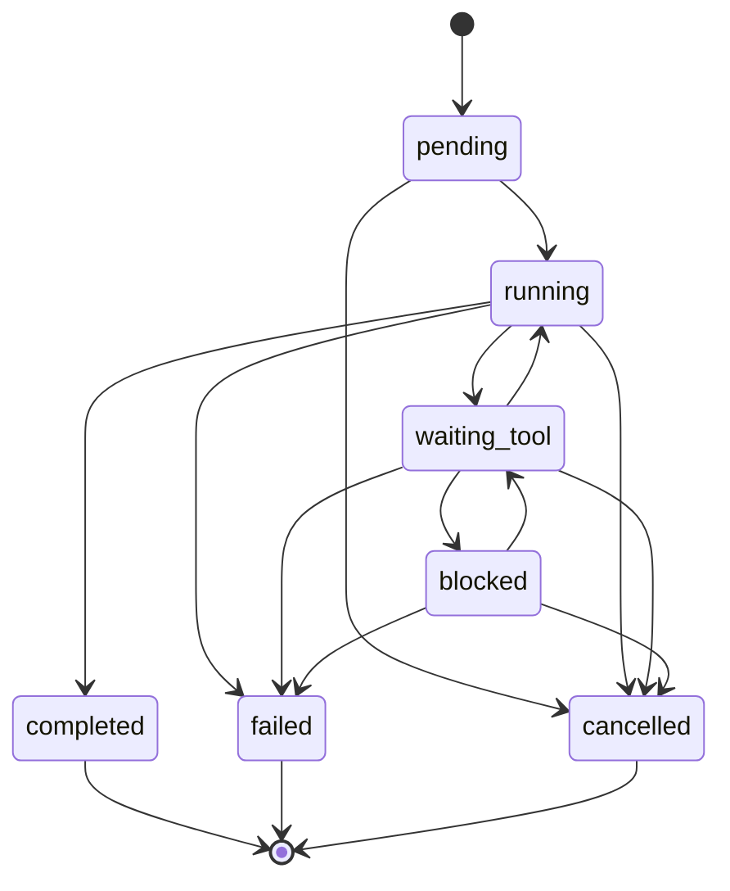

# agentflow

A small runtime for tool-using LLM agents in which every step is a SQLite transaction. A run
that crashes mid-flight can be resumed from its last committed step: tool calls whose results
were recorded are not executed again, and a tool call that was started but whose result was not
recorded is retried only if the tool is declared idempotent; otherwise the run stops for a human
decision. Tool arguments and the final answer are validated against JSON Schema, invalid output
is sent back to the model a bounded number of times, and every run has step, tool-call and
wall-clock budgets.

## Problem

An agent loop is a sequence of model calls and tool calls. In practice tools are flaky, models
return malformed arguments or answers, and processes get killed. A loop held in memory has two
bad options after a crash: start again from zero (re-running every tool, including the ones that
sent an email or opened a ticket), or loop until something outside stops it.

## Why it matters

The cost of an agent failure is usually not the failed step but what happens next: a duplicated
side effect, a silently wrong answer, or a run that never ends. Making those cases explicit
(which calls may be retried, what counts as a valid answer, when to stop) is the difference
between a demo and something that can be left running.

## What it does

- **Explicit run state machine**, persisted to SQLite and enforced on every status change
  (`src/agentflow/state.py`, `TRANSITIONS`).
- **Step checkpoints**: a model turn is committed together with the tool calls it requested; a
  tool result is committed together with the tool message the model will see
  (`src/agentflow/store.py`, `src/agentflow/runtime.py`).
- **Resume after a crash** with `agentflow resume <run_id>`; there is no separate recovery code
  path, the run loop always reads its progress from the store.
- **Tool registry** with JSON Schema arguments validated before execution, per-tool timeout,
  retry policy with exponential backoff, and an idempotency flag (`src/agentflow/tools.py`).
- **Structured output**: the final answer must be JSON matching the agent's schema. Invalid
  answers and invalid tool calls are fed back to the model with path-qualified errors, up to
  `max_repairs` times, then the run fails with the last errors (`src/agentflow/schema.py`).
- **Budgets and cancellation**: max model calls, max tool calls, an absolute wall-clock deadline
  stored with the run (it keeps counting across a crash), and cancellation from another process.
- **Fencing**: each runner claims the run with a fresh token; a stale runner's later writes fail
  with `LostOwnership`.
- **Providers**: a deterministic `ScriptedModel` (used by all tests and the demo) and an optional
  OpenAI-compatible HTTP provider (`src/agentflow/providers/openai_compat.py`), configured by
  environment variables and tested only against `httpx.MockTransport`.
- **Trace**: one JSONL file per run with timings, arguments and results, passed through a
  redaction hook before it is written; `agentflow trace <run_id>` prints a timeline. See
  [What the trace redacts](#what-the-trace-redacts).

### Retry and idempotency rules

| What happened to an attempt | idempotent tool | non-idempotent tool |
| --- | --- | --- |
| returned a value | recorded, never re-run | recorded, never re-run |
| raised `ToolError` | failed, shown to the model | failed, shown to the model |
| raised `TransientToolError` (tool says: no side effect) | retried | retried |
| timed out, or raised any other exception | retried | run moves to `blocked` |
| process died after the attempt started, before its result was committed | retried on resume | run moves to `blocked` on resume |
| arguments fail the schema, or the function cannot accept them (`inspect.signature` bind) | rejected before starting, shown to the model | rejected before starting, shown to the model |
| less time left before the deadline than the tool's timeout | started with the timeout cut to the time left | not started; the run fails with `budget_exhausted` |

Retries are bounded by the tool's `RetryPolicy.max_attempts`, including attempts interrupted by
a crash. When they run out, the failure is recorded and shown to the model. A `blocked` run waits
for `agentflow resolve <run_id> <call_id>` with `--retry` (run it again, accepting a possible
duplicate), `--fail MESSAGE` or `--result JSON` (for example after checking the external system
by hand), then `agentflow resume <run_id>`.

A call's idempotency flag and `max_attempts` are recorded when the model requests it
(`tool_calls.idempotent`, `tool_calls.max_attempts`) and those recorded values decide what happens
on resume, not the tool's current declaration. If the tool is no longer registered on resume, a
call that never started fails (definite), while a call that was interrupted mid-attempt is treated
as ambiguous using its recorded policy. If a run is cancelled or hits its deadline while an attempt
from a dead process is still `started`, that call is marked `ambiguous` (outcome unknown).

The wall-clock deadline keeps running while a run is `blocked`. Resolving a call on an expired
run is still recorded, but the next `resume` moves the run to `failed`
(`budget_exhausted: wall-clock deadline passed`) instead of continuing.

What is *not* guaranteed: exactly-once side effects. A crash after a tool's side effect but before
its result is committed cannot be distinguished from a crash before the side effect. agentflow
makes that case visible and refuses to guess for non-idempotent tools; it cannot make it
disappear. A model call lost in a crash is simply made again (it has no side effect beyond cost).

## Architecture



The diagram is generated by `agentflow.state.mermaid_diagram()` from the same `TRANSITIONS`
table the store enforces; `tests/test_state.py` fails if the two differ.

- `running`: the next step is a model call. A tool-call response moves the run to
  `waiting_tool`; a valid final answer to `completed`; an invalid one stays in `running` with a
  repair message appended.
- `waiting_tool`: requested tool calls are executed in order. Each call has its own status:
  `requested -> started -> succeeded | failed`, or `rejected` (invalid arguments, never run), or
  `ambiguous` (non-idempotent, outcome unknown).
- `blocked`: at least one call is `ambiguous`; only an operator decision, a cancel, or the
  deadline passing (checked on the next `resume`) moves it on.

| Module | Responsibility |
| --- | --- |
| `state.py` | statuses, `TRANSITIONS`, `check_transition`, Mermaid rendering |
| `store.py` | SQLite schema (`runs`, `messages`, `tool_calls`, `transitions`), fenced `Store.tx` |
| `runtime.py` | `Runtime.create/run/cancel/resolve`; `_Driver` is the run loop |
| `tools.py` | `Tool`, `ToolRegistry.check_call`, `RetryPolicy`, `invoke_with_timeout` |
| `schema.py` | JSON Schema validation and error messages used for repair |
| `agent.py` | `Agent`, `Limits`, `load_agent` (rebuilds an agent from `module:factory` on resume) |
| `providers/` | `Provider` protocol, `ScriptedModel`, `OpenAICompatibleProvider` |
| `trace.py` | JSONL writer, redactors, `format_trace` |
| `faults.py` | stall-and-kill helpers used by the crash tests and the demo |
| `examples/triage.py` | incident-triage agent over local fixtures |

Design decisions and their alternatives are in
[docs/ENGINEERING_DECISIONS.md](docs/ENGINEERING_DECISIONS.md).

## Technology choices

- **Python 3.12, standard library first.** `sqlite3`, `threading`, `argparse` and `json` cover
  storage, timeouts, CLI and traces.
- **SQLite (WAL, `synchronous=FULL`)** for checkpoints: one file per data directory, real
  transactions, no server. Durability here is per-run step checkpoints, not a shared job queue.
- **jsonschema** (Draft 2020-12) for tool arguments and model output.
- **httpx** only for the optional HTTP provider, because it ships `MockTransport` for tests.
- No agent framework. The run loop is one file, `src/agentflow/runtime.py` (`wc -l` reports 659
  lines), and every behaviour above is in it.

## Installation

Requires [uv](https://docs.astral.sh/uv/) (it installs Python 3.12 if needed).

```sh
git clone <this repository> agentflow
cd agentflow
uv sync --locked
```

## Quick start

```sh
uv run agentflow demo
```

No API key and no network. The demo:

1. creates an incident-triage run (`src/agentflow/examples/triage.py`);
2. starts it in a child process, where the flaky `search_logs` tool fails twice and is retried,
   and hard-kills that process right after the `search_logs` result is committed;
3. prints what the store recorded at the moment of the kill;
4. resumes the run in the parent process, which executes only the remaining calls, gets one
   schema-invalid answer from the model, feeds the errors back, and completes;
5. prints which tool ran in which process, the validated output, and the trace.

It uses a fresh temporary directory by default; `--workdir DIR` picks a new or empty one.

## Examples

Abridged output of `uv run agentflow demo --workdir .agentflow-demo` (run ids, pids and timings
differ per run):

```text
[2] state recorded at the moment of the kill: status=waiting_tool
    0.0 get_alert            succeeded  attempts=1
    1.0 search_logs          succeeded  attempts=3
    1.1 get_recent_deploys   requested  attempts=0

[3] resuming in a new process (this one)
    final status: completed

[4] tool executions by process (from executions.jsonl)
    killed child    get_alert            ok                x1
    killed child    search_logs          connection_error  x2
    killed child    search_logs          ok                x1
    resumed parent  create_ticket        ok                x1
    resumed parent  get_recent_deploys   ok                x1
    tickets on disk: TCK-0001.json
```

and from the trace:

```text
  tool_retry         1.0 search_logs attempt 1 error=ConnectionError: log index did not respond
  tool_finished      1.0 search_logs attempt 3 result=[...]
  run_claimed        {"model_calls": 2, "status": "waiting_tool", "tool_calls": 3}
  tool_started       1.1 get_recent_deploys attempt 1 arguments={"service": "checkout"}
  repair             output repair #1: $: 'ticket_id' is a required property; ...
  state              running -> completed  (output valid)
```

Inspecting runs (`--data-dir` goes before the subcommand; default `.agentflow`):

```sh
uv run agentflow --data-dir .agentflow-demo runs
uv run agentflow --data-dir .agentflow-demo show <run_id>
uv run agentflow --data-dir .agentflow-demo trace <run_id>        # add --json for raw events
uv run agentflow --data-dir DIR cancel <run_id>
uv run agentflow --data-dir DIR resolve <run_id> <call_id> --result '{"sent": true}'
uv run agentflow --data-dir DIR resume <run_id>
uv run agentflow --data-dir DIR start --agent package.module:factory --goal "..."
```

`start` and `resume` exit with 0 completed, 1 failed, 3 blocked, 4 cancelled, 5 still in
progress. The factory named by `--agent` takes the data directory and returns an
`agentflow.Agent`; its module must be importable (for example via `PYTHONPATH`).

Defining an agent in code (this block runs as is; `ScriptedModel` stands in for a real model):

```python
from pathlib import Path
from tempfile import mkdtemp

from agentflow import Agent, Limits, ModelResponse, RetryPolicy, Runtime, Tool, ToolCallRequest
from agentflow import ToolRegistry
from agentflow.providers import ScriptedModel


def build(data_dir: Path) -> Agent:
    lookup = Tool(
        name="lookup",
        description="Read a record.",
        parameters={
            "type": "object",
            "properties": {"id": {"type": "string"}},
            "required": ["id"],
            "additionalProperties": False,
        },
        fn=lambda id: {"id": id, "owner": "team-a"},
        idempotent=True,
        timeout_s=5,
        retry=RetryPolicy(max_attempts=3),
    )
    model = ScriptedModel(
        [
            ModelResponse(tool_calls=(ToolCallRequest("c1", "lookup", {"id": "r-1"}),)),
            ModelResponse(content='{"owner": "team-a"}'),
        ]
    )
    return Agent(
        name="example",
        system_prompt="Find the owner of record r-1.",
        tools=ToolRegistry([lookup]),
        provider=model,
        output_schema={"type": "object", "required": ["owner"]},
        limits=Limits(max_steps=10),
    )


data_dir = Path(mkdtemp())
runtime = Runtime(data_dir)
agent = build(data_dir)
run_id = runtime.create("my_module:build", "who owns r-1?", agent=agent)
print(runtime.run(run_id, agent=agent))  # RunOutcome(..., status=<RunStatus.COMPLETED ...>, ...)
runtime.close()
```

Passing `agent=` skips the import; `agent_ref` (`"my_module:build"`) is what `agentflow resume`
imports in a new process, so it must name an importable factory there.

Using a real model (optional, never needed for tests or the demo):

```sh
export AGENTFLOW_PROVIDER=openai                 # read by the triage example's factory
export AGENTFLOW_OPENAI_BASE_URL=http://localhost:8000/v1
export AGENTFLOW_OPENAI_MODEL=<model name>
export AGENTFLOW_OPENAI_API_KEY=<key>            # optional for local servers
```

## Testing

```sh
uv run ruff format --check .
uv run ruff check .
uv run mypy src
uv run pytest -q
```

`uv run pytest -q` currently collects 113 tests. The ones that carry the main claims:

| Claim | Test |
| --- | --- |
| kill between steps; recorded calls not re-run | `tests/test_crash_resume.py::test_kill_between_steps_does_not_reexecute_recorded_calls` |
| kill inside an idempotent tool; retried on resume | `test_kill_inside_idempotent_tool_retries_it_on_resume` |
| kill inside a non-idempotent tool; run blocks, not re-run | `test_kill_inside_non_idempotent_tool_blocks_for_a_human` |
| flaky tool retried with backoff | `tests/test_runtime.py::test_flaky_idempotent_tool_is_retried_with_backoff` |
| non-idempotent tool not retried after ambiguous failure | `test_non_idempotent_tool_is_not_retried_after_ambiguous_failure` |
| crash during backoff resumes as a clean retry | `test_crash_during_retry_backoff_resumes_as_clean_retry` |
| invalid output repaired, then failing after the limit | `test_invalid_output_is_repaired_with_the_validation_error`, `test_output_that_never_validates_fails_after_the_repair_limit` |
| budgets | `test_max_steps_budget`, `test_max_tool_calls_budget`, `test_wall_clock_deadline_stops_the_run`, `test_deadline_caps_the_tool_timeout` |
| timeouts | `test_idempotent_timeout_is_retried_then_reported`, `test_non_idempotent_timeout_blocks` |
| cancellation | `test_cancel_pending_run_is_immediate`, `test_cancel_requested_during_a_tool_stops_before_the_next_model_call`, `test_cancel_from_another_thread_interrupts_retry_loop` |
| fencing | `test_stale_runner_is_fenced_out` |
| expired blocked run fails cleanly; non-idempotent call not started near the deadline; unbindable arguments rejected; recorded policy wins on resume; redaction by key segment and value shape | `tests/test_regressions.py` |
| HTTP provider (mocked transport) | `tests/test_providers.py` |
| trace redaction | `tests/test_trace.py` |
| demo end to end | `tests/test_cli.py::test_demo_end_to_end` |

Crash tests start `python -m agentflow resume` in a subprocess, wait for it to reach a known
point (a marker file written right after a database commit, or from inside a tool), and kill it
with `Popen.kill` / `os.kill` (SIGKILL on Linux, TerminateProcess on Windows). CI runs the suite
on `ubuntu-latest` and `windows-latest`.

### What the trace redacts

The default redactor, `agentflow.trace.redact_sensitive_keys`, is applied to every trace event
before it is written (operator `cancel`/`resolve` events use the agent's redactor when the CLI can
build the agent, and carry only ids, tool names and statuses):

- **Keys**: the value of any dict key whose name contains `password`, `passwd`, `passphrase`,
  `secret`, `token`, `authorization`, `cookie`, `credential(s)` or `apikey` as a whole segment, or
  the adjacent segments `api key`, `access key`, `private key`, `secret key`, `signing key`.
  Names are split on non-alphanumerics and camelCase, so `x-api-key`, `apiKey` and
  `session_token` are redacted and `prompt_tokens`, `max_tokens` and `secretary` are not.
- **Values**: inside any string (goal, error messages, results, unparsed argument strings),
  substrings shaped like `sk-...` keys, GitHub tokens (`ghp_...`, `github_pat_...`), AWS access key
  ids (`AKIA...`), Slack tokens (`xox?-...`), JWTs, `Bearer <value>`, PEM private key blocks, and
  `password=...` / `"api_key": "..."` style assignments.
- **Not redacted**: secrets with any other shape under a non-sensitive key (for example a random
  string in a free-text field), personal data such as names or emails, and the SQLite store,
  which keeps the full conversation unredacted because resume needs it. Agents add their own
  rules with `chain_redactors`; the triage example adds `mask_phone_numbers`.

## Limitations

- **No exactly-once tool execution.** See the guarantees above; a non-idempotent tool needs a
  human after an ambiguous failure.
- **One runner per run.** Fencing stops a stale runner from committing, but two runners started
  on the same run at the same time can both execute an in-flight tool before one is fenced out.
  There is no lease or heartbeat; `resume` assumes the previous process is gone.
- **Timeouts cannot kill a tool.** A timed-out attempt keeps running in a daemon thread (Python
  cannot stop a thread). This is why timeouts count as ambiguous. For an idempotent tool it also
  means a retry can start while the timed-out attempt is still running, so up to `max_attempts`
  copies of one call can run at the same time.
- **`claim` does not check liveness.** `resume` takes the run over unconditionally; if the old
  process is in fact alive, fencing stops its next commit but not the tool it is running.
- **Cancellation is cooperative** at step boundaries (before each model call and each tool
  attempt). An in-flight tool or model call is not interrupted.
- **The deadline does not interrupt a model call**; the HTTP provider's own timeout bounds it.
- **Tools in one turn run sequentially.**
- **Cancelling a run whose runner died** only sets a flag; it takes effect on the next `resume`.
- **Model-call cost is not bounded by `max_steps` alone.** `max_steps` counts committed model
  turns. Each turn may be attempted `1 + model_retries` times on transient provider errors, and
  a turn lost in a crash is requested again on resume, so a run that keeps crashing before its
  turn commits makes more model calls than `max_steps`.
- **The scripted model is a script.** The demo shows the runtime's behaviour, not model quality.
- **`agent_ref` is imported on resume.** Anyone who can write the database can choose which
  importable factory runs; treat the data directory as trusted.

## Future work

- Pass an idempotency key (`run_id` + `call_id`) to tools so a non-idempotent remote API that
  supports idempotency keys can be retried safely instead of blocking.
- A lease with heartbeat so a second runner can detect that the first is still alive.
- Parallel execution of independent tool calls within one turn.
- Process-based tool isolation so a timed-out tool can actually be terminated.
- Token and cost budgets from provider `usage`.

## Licence

MIT, see [LICENSE](LICENSE).
